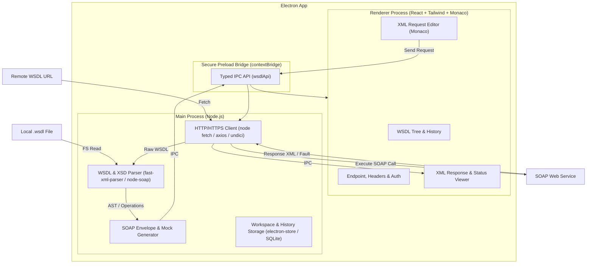

# Product Specification: WSDL Caller (Desktop Wizdler Alternative)

**Document Version:** 1.0.0  
**Status:** Draft / Proposed  
**Author:** Antigravity Team  
**Target Platform:** Desktop (macOS, Windows, Linux via Electron)

---

## 1. Executive Summary

### 1.1 Problem Statement
Developers, QA engineers, and system integrators frequently interact with legacy and enterprise SOAP web services. The classic Chrome extension **Wizdler** has long been the gold standard for quick WSDL discovery, parsing, and SOAP testing directly from a browser. However, browser extensions suffer from critical limitations:
- **CORS (Cross-Origin Resource Sharing) restrictions** block requests to arbitrary SOAP endpoints.
- Inability to ignore self-signed SSL certificates in internal/development environments.
- Browser sandbox limits: unable to read local `.wsdl` files with multi-file XSD dependencies easily.
- Manifest V3 restrictions and deprecations affecting background network hooks.

### 1.2 Vision & Solution
**WSDL Caller** is a lightweight, cross-platform Electron desktop application that emulates and modernizes the Wizdler workflow without browser constraints:
1. Provide a WSDL URL (or load a local `.wsdl` / `.zip` schema bundle).
2. Instantly parse and display all Services, Ports, and Operations in a clean tree hierarchy.
3. Automatically generate sample SOAP 1.1 and SOAP 1.2 XML request envelopes with typed dummy values.
4. Execute SOAP calls directly from Node.js (bypassing CORS, with full SSL/header/auth control).
5. Inspect formatted responses, response headers, execution timing, and SOAP Fault breakdowns.

---

## 2. Target Users & Primary Use Cases

### 2.1 Target Audience
- **Backend & Integration Engineers:** Testing enterprise SOAP endpoints (ERP, CRM, banking, telecom).
- **QA Engineers:** Verifying SOAP API contracts and error responses.
- **Frontend / Full-stack Developers:** Inspecting legacy service schemas without installing heavyweight tools like SoapUI.

### 2.2 Core Use Cases
| ID | Persona | Use Case |
|---|---|---|
| **UC-1** | Dev / QA | Paste a remote WSDL URL (e.g., `https://api.example.com/service?wsdl`) and view all exposed operations within 2 seconds. |
| **UC-2** | Integrator | Select an operation to automatically generate a boilerplate XML request envelope with pre-filled placeholders (types, booleans, enums). |
| **UC-3** | Dev | Execute the request against development, staging, or production endpoint URLs (with optional self-signed SSL verification toggle). |
| **UC-4** | Dev | View formatted response XML, detect SOAP faults, and check round-trip latency. |
| **UC-5** | QA | Test offline or internal services by importing local `.wsdl` files and associated `.xsd` schemas. |

---

## 3. Product Architecture & Technical Stack



### 3.1 Recommended Technology Stack
- **Framework:** Electron (latest LTS)
- **Renderer Frontend:** React 18+ (TypeScript), Tailwind CSS, Lucide Icons
- **Code/XML Editor:** Monaco Editor (`@monaco-editor/react`) or CodeMirror 6 (with XML syntax highlighting, folding, auto-formatting)
- **WSDL & XML Engine:**
  - `fast-xml-parser` for high-performance XML/WSDL DOM parsing
  - Custom / lightweight schema generator for SOAP 1.1 / SOAP 1.2 envelope templates
  - Optional support for `soap` (node-soap) core parsing algorithms
- **HTTP Engine:** Node.js native `fetch` / `undici` / `axios` with custom `https.Agent` support (configurable `rejectUnauthorized: false` for self-signed development environments)
- **State & Persistence:** Zustand for UI state; `electron-store` or lowdb for saving recent WSDLs, collections, and request history.

---

## 4. Detailed Functional Requirements

### 4.1 WSDL Input & Discovery
- **Remote URL Input:**
  - URL text bar with auto-validation and instant fetch.
  - HTTP Basic Auth / Bearer token support for fetching protected WSDL URLs.
  - Auto-append `?wsdl` or `?singleWsdl` suggestion if missing.
- **Local File Import:**
  - Drag-and-drop or file picker for `.wsdl` and `.xml` files.
  - Support for multi-file dependencies (schemas referencing relative `.xsd` files in the same directory or archive).
- **Recent URLs & Quick Switcher:**
  - Dropdown history of previously loaded WSDLs with quick reload.

### 4.2 Schema Parsing & Service Explorer (Sidebar)
- Hierarchical tree representation:
  - **Service Name**
    - **Port / Binding** (SOAP 1.1 vs. SOAP 1.2 designation)
      - **Operation Name** (with HTTP method / action badges)
- Quick search / filter bar to locate operations in large WSDLs (e.g., hundreds of operations).
- Detail popover displaying:
  - Input message schema & documentation.
  - Output message schema.
  - Target namespace (`targetNamespace`) and `soapAction`.
  - Default endpoint address (`soap:address location`).

### 4.3 Request Envelope Generator
- When an operation is clicked:
  - Auto-generate standard SOAP envelope:
    - SOAP 1.1: `xmlns:soapenv="http://schemas.xmlsoap.org/soap/envelope/"`
    - SOAP 1.2: `xmlns:soap="http://www.w3.org/2003/05/soap-envelope"`
  - Populate elements defined in the WSDL `<types>` / XML Schema:
    - Simple types: Pre-fill realistic placeholder values (`?string?`, `?int?`, `?boolean?`, `?dateTime?`).
    - Complex types: Recursively expand child elements with correct nesting.
    - MinOccurs / MaxOccurs indicators commented in XML (e.g. `<!-- Optional: minOccurs=0 -->`).
    - Nillable / Enum value hints commented inline.

### 4.4 Request Configuration & Execution
- **Endpoint URL:** Pre-filled from `soap:address location`, editable to point to `localhost`, staging, or tunnel proxies.
- **Headers Configuration:**
  - Auto-set `Content-Type`:
    - `text/xml; charset=utf-8` (SOAP 1.1)
    - `application/soap+xml; charset=utf-8` (SOAP 1.2)
  - Auto-set `SOAPAction` header (for SOAP 1.1) or `action` param in `Content-Type` (for SOAP 1.2).
  - Ability to add custom HTTP headers (e.g. `X-Api-Key`, custom routing headers).
- **Authentication:**
  - None
  - HTTP Basic Auth (`Authorization: Basic ...`)
  - Bearer Token (`Authorization: Bearer ...`)
  - WS-Security (UsernameToken profile: Username, Password, PasswordText / PasswordDigest, Nonce, Created).
- **SSL / TLS Options:**
  - Toggle "Ignore SSL/TLS Errors" (crucial for local/dev environments with self-signed certs).
  - Request timeout configuration (default: 30s).

### 4.5 Response Inspector
- **Formatted XML View:**
  - Syntax highlighted, collapsible tree with line numbers.
  - One-click copy, beautify, and raw response view.
  - Search within response (regex/plain text).
- **SOAP Fault Detection:**
  - Automatic detection of `<soap:Fault>` or `<soapenv:Fault>`.
  - Visual alert box summarizing:
    - Fault Code (`faultcode` / `soap:Code`)
    - Fault String / Reason (`faultstring` / `soap:Reason`)
    - Fault Actor / Detail
- **Metadata Panel:**
  - HTTP Status Code (e.g., `200 OK`, `500 Internal Server Error`).
  - Response duration (latency in ms).
  - Response payload size (KB/MB).
  - Response HTTP headers table.

### 4.6 History & Request Collections
- **History Log:** Automatic chronological history of sent requests with status, timestamp, and duration.
- **Saved Requests (Collections):** Ability to star or save configured requests with custom names for quick regression testing.
- **Import / Export:** Export saved requests and history as JSON.

---

## 5. User Interface (UI / UX) Layout

A clean, modern 3-pane desktop layout:

```
+---------------------------------------------------------------------------------------------------+
|  [ WSDL URL Input: https://example.com/ws/orders?wsdl             ] [ Load ] [ History v ] [⚙ ]   |
+----------------------+--------------------------------------------+-------------------------------+
| SERVICE EXPLORER     | REQUEST: OrderService -> GetOrderDetails   | RESPONSE: 200 OK (142ms)      |
|                      +--------------------------------------------+-------------------------------+
| Filter: [ search... ]| [Endpoint: https://api.staging.example/ws ]| Headers | Raw | XML Tree      |
|                      | [Headers (3)] [Auth: None v] [Send ▷]      |-------------------------------|
| v OrderService       |--------------------------------------------| <?xml version="1.0"?>         |
|   v OrderSoapBinding | <soapenv:Envelope xmlns:soapenv="...">     | <soapenv:Envelope ...>        |
|     > GetOrderDetails|   <soapenv:Header/>                        |   <soapenv:Body>              |
|     > CancelOrder    |   <soapenv:Body>                           |     <GetOrderDetailsResponse> |
|     > ListOrders     |     <GetOrderDetails>                      |       <OrderId>1001</OrderId> |
|   v OrderRestBinding |       <OrderId>?string?</OrderId>          |       <Status>Shipped</Status>|
|                      |     </GetOrderDetails>                     |     </GetOrderDetailsResponse>|
| v CustomerService    |   </soapenv:Body>                          |   </soapenv:Body>             |
|   > GetProfile       | </soapenv:Envelope>                        | </soapenv:Envelope>           |
|                      |                                            |                               |
| [ Recent History v ] | [Format XML] [Reset to Default]            | [Copy] [Download XML]         |
+----------------------+--------------------------------------------+-------------------------------+
```

---

## 6. Non-Functional Requirements

| Category | Requirement |
|---|---|
| **Performance** | Parse and index a 10MB WSDL with 200 operations in under 1.5 seconds. UI stays responsive during parsing. |
| **Network & Security** | Bypasses browser CORS limitations completely via Electron's Node main process. Secure IPC using `contextIsolation: true` and no `nodeIntegration` in renderer. |
| **Offline Capability**| Full functionality for local `.wsdl` files without internet connection (except sending requests if remote). |
| **Cross-Platform** | Native builds for Windows (x64/arm64), macOS (Apple Silicon & Intel), and Linux (AppImage, deb, rpm). |
| **Memory Footprint**| Idle RAM consumption under 120MB. |

---

## 7. Implementation Roadmap & Milestones

### Phase 1: MVP (Minimum Viable Product)
- [x] Basic Electron + React + TypeScript setup with Vite.
- [x] URL bar to fetch and parse remote WSDL.
- [x] Tree view listing Services, Ports, and Operations.
- [x] Template generator for SOAP 1.1 request envelopes.
- [x] Monaco/CodeMirror XML editor with "Send Request" button.
- [x] Direct Node.js HTTP call and raw/formatted response display.

### Phase 2: Feature Parity with Wizdler + Desktop Perks
- [ ] SOAP 1.2 envelope support.
- [ ] Local `.wsdl` file drag-and-drop and schema importer.
- [ ] Ignore SSL Certificate verification toggle.
- [ ] SOAP Fault status badge and highlighted breakdown.
- [ ] Custom headers and Basic/Bearer Auth configuration.
- [ ] Request history and persistence.

### Phase 3: Advanced Integrations
- [ ] WS-Security (UsernameToken) wizard.
- [ ] Environment variable manager (e.g. `{{baseUrl}}`, `{{authKey}}`).
- [ ] Postman-like collections and test assertion scripts.
- [ ] Mock SOAP service server embedded in the app.
